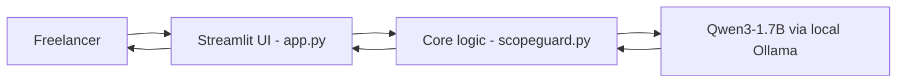
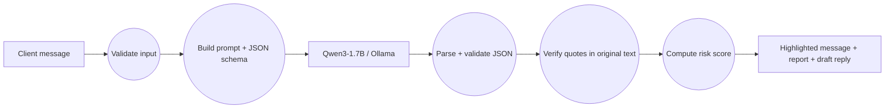
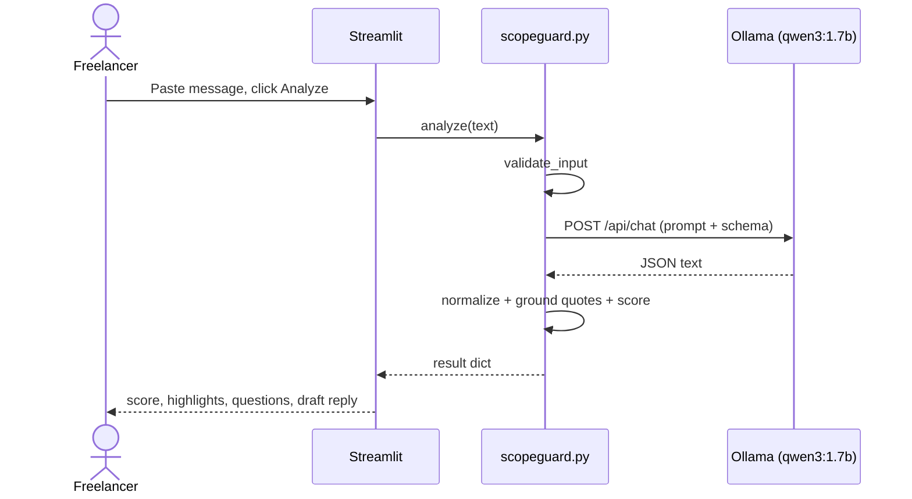

# 🛡️ ScopeGuard

**Paste a client's project message. Find scope-creep risks before you quote a price.**
Built for Hacktoberfest Lahore 2026 (Riphah International University).

## Problem and solution
**Target user:** freelancers (Upwork, Fiverr, WhatsApp clients) who get vague project messages like "small changes whenever I want, budget is flexible".
**Problem:** vague briefs lead to unpaid extra work and disputes. Pasting client messages into cloud AI tools also leaks client data.
**Solution:** ScopeGuard runs a small open-weight model **locally**, extracts the requested deliverables, lists missing information, flags risky phrases, and drafts a polite clarifying reply.

## Features
- Structured analysis (JSON-schema constrained output): summary, deliverables, missing info, risk flags, questions, draft reply.
- **Quote grounding:** every risk flag must quote the client's exact words. Code checks that the quote exists in the message; flags with invented quotes are removed and counted.
- **Deterministic risk score** computed by code (not by the model) from verified flags + missing info.
- Highlighted risky phrases inside the original message.
- Input validation, offline/model-missing error messages, one automatic retry on invalid JSON.
- 100% local: no API key, no data sent to the internet.

## AI component
| Item | Value |
|---|---|
| Model | **Qwen3-1.7B** (`qwen3:1.7b`), about 1.7B parameters (limit: 8B) |
| Runtime | **Ollama** (local), `/api/chat` endpoint |
| License of model | Apache-2.0 (Qwen team) |
| Role | Core: reads the message and produces all structured analysis; without it the app has no output |
| Integration | `scopeguard.py::call_model` sends system prompt + client message with a JSON schema (`format`) and `think: false`; output is parsed, shape-validated, then quote-verified |

The code never fabricates a result: if the model is offline or returns unusable output, the user sees an error.

## Architecture


## Data flow


## Sequence


## Setup
Requires Python 3.10+ and [Ollama](https://ollama.com).
```bash
ollama pull qwen3:1.7b          # about 1.4 GB, one time
git clone https://github.com/saadmanzoor2/scopeguard.git scopeguard && cd scopeguard
python -m venv .venv
source .venv/bin/activate      # Windows: .venv\Scripts\activate
pip install -r requirements.txt
streamlit run app.py
```
Optional environment variables (see `.env.example`): `OLLAMA_URL`, `OLLAMA_MODEL` (e.g. `qwen3:4b` for a larger model; keep it at or below 8B).
Windows PowerShell: `$env:OLLAMA_MODEL="qwen3:4b"` before `streamlit run app.py`.

## Usage example
Click **Load vague brief** in the sidebar, then **Analyze brief**. Input: *"...You can make small changes whenever I want, right?... Budget is flexible, we can discuss after you start."* Expected: several highlighted risky phrases (revisions, budget, deadline), a Medium/High risk score, and a draft reply with clarifying questions.

## Testing
Offline unit tests (no model needed): `python -m pytest -q`
Live model check (Ollama running): `python tests/live_check.py`

| # | Scenario | Expected | Actual | Status |
|---|---|---|---|---|
| 1 | Offline unit tests (8 tests: validation, JSON parsing, grounding, scoring, HTML escape, fake-model pipeline, offline error) | all pass | 8 passed on author's Ubuntu laptop | PASS |
| 2 | Vague brief, real model | >= 2 verified flags, Medium/High | 2 verified flags (vague scope, revisions), score 43 (Medium). Missed the ASAP deadline and flexible budget. | PASS |
| 3 | Clear brief, real model | lower score than vague brief | Score 41 (Medium), only 2 points below the vague brief. Flagged "Deadline: 30 November" as high risk (false positive). 1 invented-quote flag was removed by the checker. | PASS (weak separation) |
| 4 | Ollama stopped | friendly error, no crash | PENDING | PENDING |
| 5 | Empty / 5-character input | validation error | PENDING | PENDING |

Update the Actual/Status columns with what you really observe.

## Known limitations
- Tested with the 1.7B model: it over-flagged a clear brief and missed some risks (see test table). Small models can miss risks or give weak "why" text; the quote check removes invented quotes but cannot prove the reasoning is right.
- Tuned for English (Roman Urdu messages are not tested).
- Risk score weights are hand-chosen, not statistically validated.
- Not legal advice.

## Team
- Saad Manzoor : Set up and ran the project end to end (Ollama, Qwen3-1.7B model,
  Python environment), ran the offline tests and the live model tests on a real
  laptop, recorded the actual results and limitations in this README, created and
  published the GitHub repository, and prepared the demo. The initial code, prompt
  design and documentation were drafted with Claude (an AI assistant); we reviewed,
  tested and edited them. 


## License and acknowledgements
MIT License (see `LICENSE`). Uses Qwen3-1.7B (Qwen team, Apache-2.0), Ollama (MIT), Streamlit (Apache-2.0), Requests (Apache-2.0), pytest (MIT). AI coding assistance was used during development; design decisions, testing and demo are the team's own.
